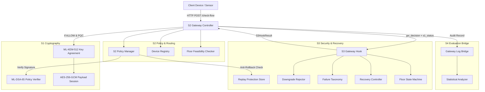
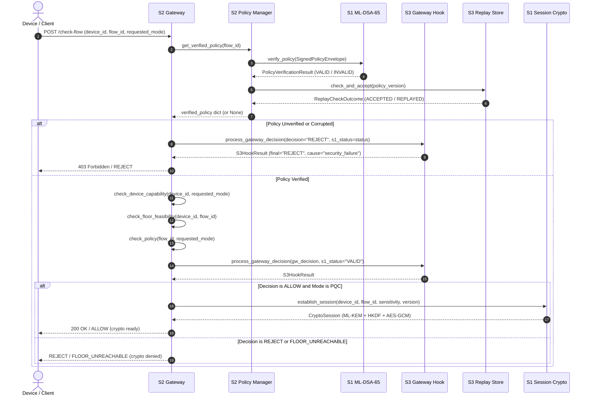

# QERIS Architecture Specification

**Project:** Sensitivity-Aware and Failure-Resilient Post-Quantum Migration Gateway  
**System Version:** 2.0.0 (Unified S1–S4 Backend)  
**Status:** Integrated Architecture Specification  

---

## 1. System Overview

QERIS is a modular, sensitivity-aware post-quantum migration gateway designed to mediate IoT and telemetry flows transitioning from classical cryptographic mechanisms to post-quantum cryptography (PQC). The gateway balances security requirements against embedded operational constraints through failure-classified recovery, strict security floor enforcement, and context-bound post-quantum session encryption.

The architecture comprises four coordinated subsystems:
- **S1 (Cryptography & Device Engine):** Post-quantum cryptographic primitives (ML-DSA-65 signatures, ML-KEM-512 key encapsulation), HKDF-SHA256 session key derivation, and AES-256-GCM authenticated message encryption.
- **S2 (Gateway & Policy Engine):** REST API gateway, canonical 5-field policy contract validation, device capability evaluation, and security floor enforcement.
- **S3 (Security & Recovery Logic):** Failure taxonomy classification, downgrade rejection, persistent anti-rollback replay protection, and bounded state machine recovery.
- **S4 (Data Science & Analytics):** Evaluation harness, fault injection simulation, shared logging bridge, and publication-grade statistical analytics.

---

## 2. Subsystem Roles and Interfaces

### 2.1 S1 — Cryptography & Device Engine
- **Policy Signature Operations:** Implements FIPS 204 `ML-DSA-65` digital signatures to authenticate policy payloads. Exports `sign_policy()`, `verify_policy()`, and envelope structures (`SignedPolicyEnvelope`).
- **Session Key Establishment:** Implements FIPS 203 `ML-KEM-512` key encapsulation mechanism. Generates keypairs, encapsulates ciphertexts, and decapsulates shared secrets.
- **Context-Bound Key Derivation:** Combines the KEM shared secret with an unambiguous length-prefixed context (`device_id`, `flow_id`, `sensitivity`, `policy_version`) using RFC 5869 `HKDF-SHA256`.
- **Payload Encryption:** Enforces `AES-256-GCM` with a 96-bit monotonic counter nonce and authenticated associated data (AAD). Rejects replayed or out-of-order counter tags.

### 2.2 S2 — Gateway & Policy Engine
- **REST Gateway:** Exposes endpoints (`/health`, `/check-flow`, `/crypto-demo`, `/reload-policies`) using FastAPI.
- **Canonical 5-Field Policy Contract:** Maintains the single source of truth for flow policies (`flow_id`, `sensitivity`, `minimum_mode`, `policy_version`, `authority_id`).
- **Policy Lifecycle & Authority Pinned Registry:** Manages the gateway trust anchor (`QERIS-GATEWAY`), validates signed policy envelopes, and prevents unauthenticated execution.
- **Device Capability Checks:** Matches requested modes against registered device hardware profiles (`devices.json`).
- **Feasibility Evaluation:** Pre-evaluates whether a device's maximum security capability can satisfy a flow's minimum security floor.

### 2.3 S3 — Security & Recovery Logic
- **Gateway Hook (`S3GatewayHook`):** Central mediator translating gateway decisions and S1 verification codes into classified security events.
- **Downgrade Rejection (`DowngradeRejector`):** Blocks any attempt to negotiate a cryptographic mode weaker than the flow's policy floor.
- **Replay & Fast-Forward Protection (`ReplayProtection`):** Atomically manages monotonic version counters with SHA-256 integrity validation and fast-forward bounds.
- **Failure Taxonomy (`FailureTaxonomy`):** Categorizes failures into four strictly ordered classes: $\text{SECURITY\_FAILURE} > \text{MTU\_FRAGMENT} > \text{LOSS\_TIMEOUT} > \text{COMPUTE}$.
- **Recovery Controller (`RecoveryController`):** Computes bounded exponential backoff retries for transient transport failures while terminating immediately on security violations.
- **Floor State Machine (`FlowState`):** Manages flow lifecycles (`REGISTERED` $\to$ `NEGOTIATING` $\to$ `ACTIVE` $\to$ `DEGRADED` / `QUARANTINED`).

### 2.4 S4 — Data Science & Analytics
- **Evaluation Suite:** Evaluates gateway decisions against injected faults (`GroundTruthHarness`, `SoftwareFaultSimulator`).
- **Gateway Log Bridge (`GatewayLogBridge`):** Converts operational audit logs into canonical `LogRecord` objects.
- **Statistical Analytics (`StatisticalAnalyzer`):** Computes Wilson score confidence intervals, non-parametric median/IQR dispersion, and multiclass confusion matrices.

---

## 3. Policy Enforcement and Decision Sequence

Every flow authorization request executes through an explicit, fail-closed sequence:

---

## 4. Cryptographic Session Lifecycle

Cryptographic sessions are strictly bounded to verified context:

1. **Precondition Gating:** A session can only be initialized if:
   - S1 policy signature verification succeeded.
   - S2 device capability and floor checks succeeded.
   - S3 security hook returned `ALLOW` with `cause_label="none"`.
   - Requested mode is explicitly `PQC` (or `PQ`).
2. **KEM Exchange:**
   - Receiver generates ML-KEM-512 keypair $(pk, sk)$.
   - Sender encapsulates to $pk \to (ct, ss_{\text{sender}})$.
   - Receiver decapsulates $ct$ using $sk \to ss_{\text{receiver}}$.
   - Assertion: $ss_{\text{sender}} == ss_{\text{receiver}}$.
3. **Context-Bound Key Derivation:**
   $$K_{\text{session}} = \text{HKDF-Expand}(\text{HKDF-Extract}(\text{SALT}, ss), \text{ContextInfo}, 32)$$
   $$\text{ContextInfo} = \text{Label} \,\|\, |dev| \,\|\, dev \,\|\, |flow| \,\|\, flow \,\|\, |sens| \,\|\, sens \,\|\, version$$
4. **Message Encryption and Authentication:**
   - Messages are encrypted via `AES-256-GCM` using $K_{\text{session}}$.
   - Nonce is a monotonic 96-bit counter incremented per message.
   - Associated Authenticated Data (AAD) binds the identical context to the ciphertext tag.
   - Receiver strictly rejects replayed or decremented counter tags.

---

## 5. Security Invariants and Boundaries

| Invariant ID | Name | Architectural Guarantee |
|:---|:---|:---|
| **INV-1** | Authentication Before Anti-Rollback | Signatures are verified before inspecting version numbers; forged versions cannot mask attack origins. |
| **INV-2** | Never Active Below Floor | A flow can never enter the `ACTIVE` state at a cryptographic mode lower than its policy floor. |
| **INV-3** | No Fallback on Security Failure | Security violations terminate immediately (`DISCARD_AND_LOG` / `QUARANTINE`); retries are forbidden. |
| **INV-4** | Crypto Gating | Cryptographic session establishment is inaccessible to rejected or unverified requests. |
| **INV-5** | Fail-Closed Persistence | Corrupted version stores or tampered SHA-256 digests cause immediate refusal to load policies. |
| **INV-6** | Explicit Mode Support | Unsupported modes (`CLASSICAL`, `HYBRID` crypto handshakes) raise explicit errors; no silent downgrades or fake implementations. |
| **INV-7** | Zero Secret Leakage | Private keys, shared secrets, session keys, and plaintext are excluded from audit logs and git tracking. |

---

## 6. Traceability and Event Flow

Every transaction generates a correlation `trace_id` (UUIDv4) that propagates through S1, S2, S3, and S4 audit logs:

$$\text{Client Request} \xrightarrow{\text{trace\_id}} \text{S2 Gateway} \xrightarrow{\text{trace\_id}} \text{S3 Hook} \xrightarrow{\text{trace\_id}} \text{Audit Logger} \xrightarrow{\text{trace\_id}} \text{S4 Bridge}$$

The resulting logs allow complete offline reconstruction of decision paths, security classifications, and recovery attempts without storing confidential payload data.
