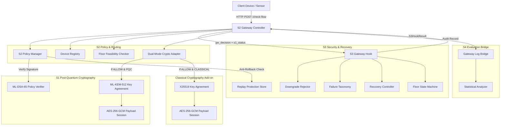
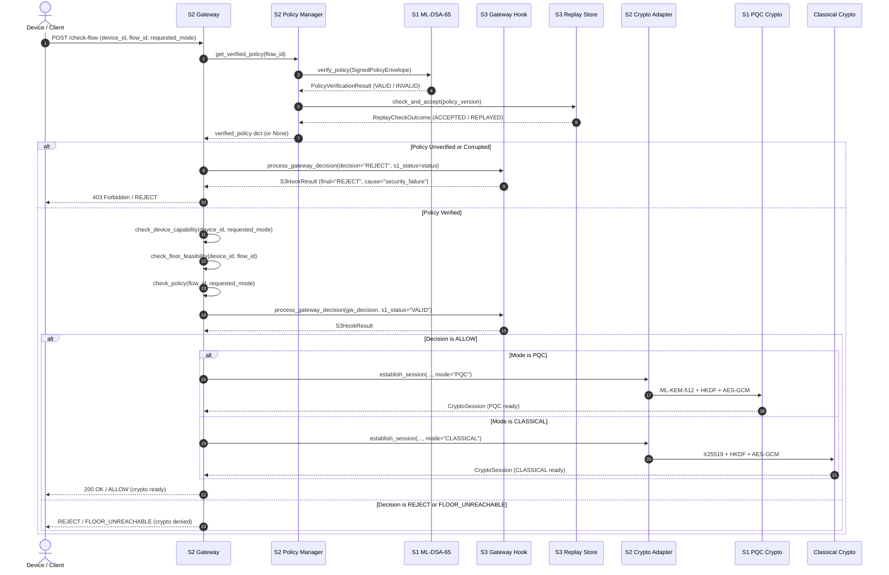

# QERIS Architecture Specification

**Project:** Sensitivity-Aware and Failure-Resilient Post-Quantum Migration Gateway  
**System Version:** 2.1.0 (Dual-Mode CLASSICAL + PQC Migration Gateway)  
**Status:** Integrated Architecture Specification  

---

## 1. System Overview

QERIS is a modular, sensitivity-aware post-quantum migration gateway designed to mediate IoT and telemetry flows transitioning from classical cryptographic mechanisms to post-quantum cryptography (PQC). The gateway balances security requirements against embedded operational constraints through failure-classified recovery, strict security floor enforcement, and context-bound cryptographic session encryption.

The architecture supports dual selectable cryptographic pathways:
1. **PQC Mode:** FIPS 203 `ML-KEM-512` key encapsulation mechanism + `HKDF-SHA256` + `AES-256-GCM`.
2. **CLASSICAL Mode:** RFC 7748 `X25519` key agreement + `HKDF-SHA256` + `AES-256-GCM`.

All policy governance is secured using FIPS 204 `ML-DSA-65` digital signatures.

The architecture comprises four coordinated subsystems:
- **S1 (Cryptography & Device Engine):** Post-quantum cryptographic primitives (ML-DSA-65 policy signatures, ML-KEM-512 key encapsulation), HKDF-SHA256 session key derivation, and AES-256-GCM authenticated message encryption.
- **S2 (Gateway & Policy Engine):** REST API gateway, canonical 5-field policy contract validation, device capability evaluation, dual-mode crypto adapter, and security floor enforcement.
- **S3 (Security & Recovery Logic):** Failure taxonomy classification, downgrade rejection, persistent anti-rollback replay protection, and bounded state machine recovery.
- **S4 (Data Science & Analytics):** Evaluation harness, fault injection simulation, shared logging bridge, and publication-grade statistical analytics.

---

## 2. Subsystem Roles and Interfaces

### 2.1 S1 — Cryptography & Device Engine
- **Policy Signature Operations:** Implements FIPS 204 `ML-DSA-65` digital signatures to authenticate policy payloads. Exports `sign_policy()`, `verify_policy()`, and envelope structures (`SignedPolicyEnvelope`).
- **Session Key Establishment:** Implements FIPS 203 `ML-KEM-512` key encapsulation mechanism. Generates keypairs, encapsulates ciphertexts, and decapsulates shared secrets.
- **Context-Bound Key Derivation:** Combines the KEM shared secret with an unambiguous length-prefixed context (`device_id`, `flow_id`, `sensitivity`, `policy_version`) using RFC 5869 `HKDF-SHA256`.
- **Payload Encryption:** Enforces `AES-256-GCM` with a 96-bit monotonic counter nonce and authenticated associated data (AAD). Rejects replayed or out-of-order counter tags.

### 2.2 S2 — Gateway & Policy Engine
- **REST Gateway:** Exposes endpoints (`/health`, `/check-flow`, `/crypto-demo`, `/reload-policies`) using FastAPI.
- **Canonical 5-Field Policy Contract:** Maintains the single source of truth for flow policies (`flow_id`, `sensitivity`, `minimum_mode`, `policy_version`, `authority_id`).
- **Policy Lifecycle & Authority Pinned Registry:** Manages the gateway trust anchor (`QERIS-GATEWAY`), validates signed policy envelopes, and prevents unauthenticated execution.
- **Device Capability Checks:** Matches requested modes against registered device hardware profiles (`devices.json`).
- **Feasibility Evaluation:** Pre-evaluates whether a device's maximum security capability can satisfy a flow's minimum security floor.
- **Dual-Mode Crypto Adapter (`crypto_adapter.py`):** Unifies session establishment across `PQC` (ML-KEM-512) and `CLASSICAL` (X25519) modes. Rejects `HYBRID` explicitly with `UnsupportedCryptoModeError`.

### 2.3 S3 — Security & Recovery Logic
- **Gateway Hook (`S3GatewayHook`):** Central mediator translating gateway decisions and S1 verification codes into classified security events.
- **Downgrade Rejection (`DowngradeRejector`):** Blocks any attempt to negotiate a cryptographic mode weaker than the flow's policy floor.
- **Replay & Fast-Forward Protection (`ReplayProtection`):** Atomically manages monotonic version counters with SHA-256 integrity validation and fast-forward bounds.
- **Failure Taxonomy (`FailureTaxonomy`):** Categorizes failures into four strictly ordered classes: $\text{SECURITY\_FAILURE} > \text{MTU\_FRAGMENT} > \text{LOSS\_TIMEOUT} > \text{COMPUTE}$.
- **Recovery Controller (`RecoveryController`):** Computes bounded exponential backoff retries for transient transport failures while terminating immediately on security violations.
- **Floor State Machine (`FlowState`):** Manages flow lifecycles (`REGISTERED` $\to$ `NEGOTIATING` $\to$ `ACTIVE` $\to$ `DEGRADED` / `QUARANTINED`).

### 2.4 S4 — Data Science & Analytics
- **Evaluation Suite:** Evaluates gateway decisions against injected faults (`GroundTruthHarness`, `SoftwareFaultSimulator`).
- **Gateway Log Bridge (`GatewayLogBridge`):** Converts operational audit logs into canonical `LogRecord` objects.
- **Statistical Analytics (`StatisticalAnalyzer`):** Computes Wilson score confidence intervals, non-parametric median/IQR dispersion, and multiclass confusion matrices.

---

## 3. Policy Enforcement and Decision Sequence

Every flow authorization request executes through an explicit, fail-closed sequence:

---

## 4. Cryptographic Session Lifecycle

Cryptographic sessions are strictly bounded to verified context across both supported modes:

### 4.1 Mode Precondition Gating
A session can only be initialized if:
1. S1 policy signature verification succeeded.
2. Policy anti-rollback validation succeeded.
3. S2 device capability and security floor checks succeeded.
4. S3 security hook returned `ALLOW` with `cause_label="none"`.
5. Requested mode is explicitly supported (`PQC` or `CLASSICAL`).

### 4.2 Post-Quantum Cryptography (PQC) Path
- **Key Agreement:** FIPS 203 `ML-KEM-512`.
  - Receiver generates keypair $(pk, sk)$.
  - Sender encapsulates to $pk \to (ct, ss_{\text{sender}})$.
  - Receiver decapsulates $ct$ using $sk \to ss_{\text{receiver}}$.
  - Both parties derive identical 32-byte shared secret $ss$.
- **Session Key Derivation:**
  $$K_{\text{session}} = \text{HKDF-Expand}(\text{HKDF-Extract}(\text{SALT}, ss), \text{ContextInfo}, 32)$$
  $$\text{SALT} = \text{"QERIS-HKDF-SHA256-SALT-v1"}$$
  $$\text{ContextInfo} = \text{"QERIS-SESSION-KEY-v1"} \,\|\, |dev| \,\|\, dev \,\|\, |flow| \,\|\, flow \,\|\, |sens| \,\|\, sens \,\|\, version$$
- **Authenticated Encryption:**
  - `AES-256-GCM` using $K_{\text{session}}$.
  - Framing: `b"QMSG\x01" || counter (8 bytes) || ciphertext || tag (16 bytes)`.
  - Nonce: 12-byte `b"\x00\x00\x00\x00" || counter (8 bytes)`.
  - AAD: Full `ContextInfo` bound to authentication tag.

### 4.3 Classical Cryptography Path
- **Key Agreement:** RFC 7748 `X25519`.
  - Alice generates ephemeral private key $a$ and public key $A = a \cdot G$ (32 bytes).
  - Bob generates ephemeral private key $b$ and public key $B = b \cdot G$ (32 bytes).
  - Both parties compute shared secret $ss = a \cdot B = b \cdot A$ (32 bytes).
- **Session Key Derivation:**
  Identical RFC 5869 `HKDF-SHA256` expansion with the same salt, label, and context-binding info as the PQC path.
- **Authenticated Encryption:**
  Identical `AES-256-GCM` message envelope, monotonic 96-bit counter nonce, and context-bound AAD.

### 4.4 Downgrade Prevention & Security Floor Enforcement
- **Security Levels:** $\text{CLASSICAL (1)} < \text{HYBRID (2)} < \text{PQC (3)}$.
- **Policy Security Floor:** Each flow declares `minimum_mode`.
- If a flow requires `PQC` (level 3) or `HYBRID` (level 2), requesting `CLASSICAL` (level 1) fails policy evaluation (`mode_below_floor`).
- S3 classifies the event as `security_failure` $\to$ `DISCARD_AND_LOG`.
- Gateway refuses to initialize any cryptographic session (`crypto_status="REJECTED_BEFORE_SESSION"`).

### 4.5 HYBRID Mode Status
- `HYBRID` is explicitly **unsupported**.
- Requests for `HYBRID` mode raise `UnsupportedCryptoModeError` in `crypto_adapter.py`.
- Gateway returns `decision="REJECT"` and `crypto_status="UNSUPPORTED_MODE"`.
- HYBRID requests are never silently routed to CLASSICAL or PQC.

---

## 5. Peer Authentication Limitations for X25519

X25519 is an unauthenticated Diffie-Hellman key agreement mechanism:

1. **Demonstration Scope vs. Network Deployment:**
   - In the current architecture, X25519 key exchange operates as a local in-process demonstration.
   - S1 implements FIPS 204 `ML-DSA-65` digital signatures strictly for **policy authority authentication** (`authority_id = "QERIS-GATEWAY"`), not for device-level identity certificates.
   - The device registry (`devices.json`) verifies hardware capabilities (which modes a device supports), but does not store device public keys or root certificates.
2. **Context Binding vs. Peer Authentication:**
   - Both parties cryptographically bind the derived session key to the claimed `device_id` string via HKDF context and AES-GCM AAD.
   - However, without an authenticated certificate or signature over the ephemeral X25519 public key, an active Man-In-The-Middle (MITM) network adversary could intercept and substitute ephemeral public keys.
3. **Production Path:**
   - A real-world network deployment must authenticate X25519 ephemeral keys using a Public Key Infrastructure (e.g., mTLS, X.509 certificates, or digital signatures over public keys such as Ed25519 or ML-DSA).

---

## 6. Security Invariants and Boundaries

| Invariant ID | Name | Architectural Guarantee |
|:---|:---|:---|
| **INV-1** | Authentication Before Anti-Rollback | Signatures are verified before inspecting version numbers; forged versions cannot mask attack origins. |
| **INV-2** | Never Active Below Floor | A flow can never enter the `ACTIVE` state at a cryptographic mode lower than its policy floor. |
| **INV-3** | No Fallback on Security Failure | Security violations terminate immediately (`DISCARD_AND_LOG` / `QUARANTINE`); retries are forbidden. |
| **INV-4** | Crypto Gating | Cryptographic session establishment is inaccessible to rejected or unverified requests. |
| **INV-5** | Fail-Closed Persistence | Corrupted version stores or tampered SHA-256 digests cause immediate refusal to load policies. |
| **INV-6** | Explicit Mode Support | `PQC` and `CLASSICAL` are supported; `HYBRID` is explicitly unsupported (fails closed). No silent downgrades. |
| **INV-7** | Zero Secret Leakage | Private keys, shared secrets, session keys, and plaintext are excluded from audit logs and git tracking. |

---

## 7. Traceability and Event Flow

Every transaction generates a correlation `trace_id` (UUIDv4) that propagates through S1, S2, S3, and S4 audit logs:

$$\text{Client Request} \xrightarrow{\text{trace\_id}} \text{S2 Gateway} \xrightarrow{\text{trace\_id}} \text{S3 Hook} \xrightarrow{\text{trace\_id}} \text{Audit Logger} \xrightarrow{\text{trace\_id}} \text{S4 Bridge}$$

The resulting logs allow complete offline reconstruction of decision paths, security classifications, and recovery attempts without storing confidential payload data.

---

## 8. Integration Test Verification

The integration is verified by end-to-end tests in `tests/test_backend_integration.py`:

| Test Name | Verified Property |
|:---|:---|
| `test_01_canonical_policy_loading_and_s1_verification` | Canonical 5-field policy loading & S1 ML-DSA-65 verification |
| `test_02_valid_flow_request_evaluates_to_allow` | Valid flow request evaluation |
| `test_03_downgrade_attempt_caught_by_s2_and_s3` | Downgrade caught by S2 & S3 |
| `test_04_floor_unreachable_identified` | Unreachable device security floor detection |
| `test_05_unknown_device_rejected` | Unknown device rejected |
| `test_06_tampered_policy_signature_rejected_by_s1_and_quarantined_by_s3` | Tampered policy quarantine |
| `test_07_untrusted_authority_rejected` | Untrusted authority rejection |
| `test_08_crypto_demo_success_on_allowed_pqc_request` | PQC crypto session roundtrip |
| `test_09_crypto_demo_fails_closed_on_rejected_request` | Fail-closed crypto session gating |
| `test_10_hybrid_mode_explicitly_unsupported` | HYBRID mode explicit rejection |
| `test_11_audit_log_format_and_s4_compatibility` | S4 log schema compatibility |
| `test_12_classical_key_agreement_success` | Successful CLASSICAL X25519 key agreement |
| `test_13_classical_session_encryption_and_decryption_roundtrip` | CLASSICAL AES-256-GCM encryption/decryption roundtrip |
| `test_14_classical_tampered_ciphertext_and_tag_rejected` | Tampered CLASSICAL ciphertext / tag rejection |
| `test_15_classical_malformed_key_material_rejected` | Malformed key material rejection |
| `test_16_classical_replay_and_context_binding_enforced` | Replay protection & context binding on CLASSICAL path |
| `test_17_pqc_operation_unaffected_after_classical_integration` | PQC ML-KEM-512 operation verified intact after integration |
| `test_18_pqc_floor_rejects_classical_downgrade` | CLASSICAL downgrade rejected when policy requires PQC |
| `test_19_hybrid_floor_rejects_classical_downgrade` | CLASSICAL downgrade rejected when policy requires HYBRID |

Every transaction generates a correlation `trace_id` (UUIDv4) that propagates through S1, S2, S3, and S4 audit logs:

$$\text{Client Request} \xrightarrow{\text{trace\_id}} \text{S2 Gateway} \xrightarrow{\text{trace\_id}} \text{S3 Hook} \xrightarrow{\text{trace\_id}} \text{Audit Logger} \xrightarrow{\text{trace\_id}} \text{S4 Bridge}$$

The resulting logs allow complete offline reconstruction of decision paths, security classifications, and recovery attempts without storing confidential payload data.
