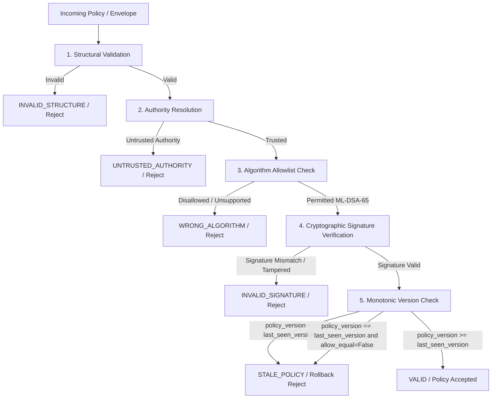

# QERIS Canonical Policy Contract

**Version:** 1.0.0  
**Status:** Canonical Reference Standard  
**Subsystems Governed:** S1 (Cryptography), S2 (Gateway), S3 (Security & Recovery), S4 (Data Science & Evaluation)

---

## 1. Executive Summary

This document defines the single source of truth for policy representation, serialization, signing, verification, authority binding, and version semantics across the QERIS platform.

Under this contract:
- **S2's 5-field schema is the canonical data model.** S1, S3, and S4 align strictly with this model.
- Cryptographic signatures are decoupled into an explicit envelope, isolating policy attributes from cryptographic metadata.
- Policy evaluation follows **strict authentication before anti-rollback**, preventing forged lower-version policies from evading detection.

---

## 2. Canonical Five-Field Policy Schema

Every policy entry representing a telemetry flow consists of exactly five fields:

```json
{
  "flow_id": "temperature_01",
  "sensitivity": "LOW",
  "minimum_mode": "CLASSICAL",
  "policy_version": 1,
  "authority_id": "QERIS-GATEWAY"
}
```

### Field Definitions & Invariants

| Field | Type | Allowed Values / Constraints | Semantics |
| :--- | :--- | :--- | :--- |
| `flow_id` | `string` | Non-empty, UTF-8 string without unpaired surrogates. | Unique identifier of the data stream or sensor topic. |
| `sensitivity` | `string` | `"LOW"`, `"MEDIUM"`, `"HIGH"`, `"CRITICAL"` | Security categorization determining minimum cryptographic requirements. |
| `minimum_mode` | `string` | `"CLASSICAL"`, `"HYBRID"`, `"PQC"`, `"PQ"` | Lowest acceptable security mode required to transmit this flow. |
| `policy_version` | `integer` | Positive integer ($\ge 1$). Booleans, floats, non-integers, and values $\le 0$ are rejected. | Monotonic sequence number for anti-rollback protection. |
| `authority_id` | `string` | Non-empty, UTF-8 string without unpaired surrogates. | Identifier of the issuing trust authority (e.g., `"QERIS-GATEWAY"`). |

### Strict Schema Rules
1. **No Extra Fields:** Any extra or undeclared fields in the policy payload cause immediate rejection (`INVALID_STRUCTURE`).
2. **No Missing Fields:** All five fields are strictly mandatory.
3. **Strict Types:** Types must match exactly (e.g., `"1"` or `True` is rejected for `policy_version`).
4. **No Legacy Fields:** The old 6-field provisional schema (`version`, `sig_alg`, `flow_to_tier`, `tier_to_suite`, `expiry`, `revocation_list`) is deprecated and removed from active verification.

---

## 3. Explicit Signature Envelope

Signature metadata is strictly separated from the signed policy payload using `SignedPolicyEnvelope`:

```json
{
  "policy": {
    "flow_id": "temperature_01",
    "sensitivity": "LOW",
    "minimum_mode": "CLASSICAL",
    "policy_version": 1,
    "authority_id": "QERIS-GATEWAY"
  },
  "sig_alg": "ML-DSA-65",
  "signature": "3c7b..."
}
```

### Envelope Fields
- `policy`: Canonical 5-field mapping.
- `sig_alg`: Post-quantum signature algorithm identifier (`"ML-DSA-65"`).
- `signature`: Raw signature bytes (or lowercase hex string in serialized storage/transmissions).

---

## 4. Deterministic Canonical Serialization

Cryptographic signing and verification require that both endpoints serialize identical JSON objects to identical byte sequences.

### Serialization Rules (`serialize_policy_to_bytes`)
1. **Lexicographical Key Sorting:** Keys are sorted alphabetically (`sort_keys=True`).
2. **Compact Separators:** Exactly `','` between elements and `':'` between key-value pairs (no extraneous whitespace).
3. **Encoding:** Strict UTF-8 without byte-order marks.
4. **Rejection of Non-Standard Floats:** `NaN`, `Infinity`, and `-Infinity` are strictly rejected (`allow_nan=False`).
5. **Rejection of Duplicate Keys:** Deserialization employs strict object pair hooks; duplicate keys raise `ValueError`.

### Canonical Example Byte Sequence
For the policy:
```json
{
  "flow_id": "heart_rate_flow",
  "sensitivity": "CRITICAL",
  "minimum_mode": "PQC",
  "policy_version": 1,
  "authority_id": "QERIS-GATEWAY"
}
```
The exact UTF-8 serialized byte sequence is:
```text
b'{"authority_id":"QERIS-GATEWAY","flow_id":"heart_rate_flow","minimum_mode":"PQC","policy_version":1,"sensitivity":"CRITICAL"}'
```

---

## 5. Trusted Authority Public Key Resolution

1. **Pinned Authority Registry:** The gateway and verifiers maintain an authoritative mapping of `authority_id` $\to$ public key bytes:
   ```python
   authority_registry = {
       "QERIS-GATEWAY": b"<ML-DSA-65 public key 1952 bytes>"
   }
   ```
2. **Never Trust Unverified Keys:** Policies never transport their own public key. Public keys provided directly in unverified policy structures are rejected.
3. **Unknown Authorities:** If `authority_id` is missing from `authority_registry`, verification fails immediately with status `UNTRUSTED_AUTHORITY`.

---

## 6. Verification Workflow & Anti-Rollback Semantics

To prevent attackers from masking forged signatures as version rollbacks (or vice versa), the gateway executes verification in a strictly defined order:



### Version State Rules
- **Authentication Precedes Anti-Rollback:** A forged signature with a lower version returns `INVALID_SIGNATURE`, never `STALE_POLICY`.
- **Fail-Closed State:** The persistent version store (`ReplayProtection`) fails closed if corrupted.
- **Atomic State Advancement:** Gateway version state advances only upon `VALID` policy verification.

---

## 7. Verification Status Code Mapping

| Status Code | Description | Gateway / S3 Action |
| :--- | :--- | :--- |
| `VALID` | Structure, signature, authority, and version are authentic and fresh. | Accept policy; advance version state. |
| `INVALID_STRUCTURE` | Missing fields, bad types, duplicate keys, or malformed JSON. | Fail-closed rejection (`CORRUPTED_POLICY`). |
| `UNTRUSTED_AUTHORITY` | `authority_id` not in local trust registry. | Quarantine device / reject (`UNKNOWN_AUTHORITY`). |
| `WRONG_ALGORITHM` | Signature algorithm not in verifier's allowed list. | Reject (`ALGORITHM_MISMATCH`). |
| `UNSUPPORTED_ALGORITHM` | Algorithm not supported by local cryptographic engine. | Reject (`UNSUPPORTED_ALGORITHM`). |
| `INVALID_SIGNATURE` | Cryptographic signature verification failed (tampered data or bad key). | Security alert / reject (`SIGNATURE_FAILURE`). |
| `STALE_POLICY` | Authenticated policy presents rolled-back version number. | Anti-rollback alert / reject (`REPLAY_POLICY`). |

---

## 8. S1 and S2 Compatibility Checklist

- [x] S1 `serialization.py` enforces canonical 5 fields (`CANONICAL_POLICY_FIELDS`).
- [x] S1 `signed_policy.py` validates canonical 5 fields and provides `SignedPolicyEnvelope`.
- [x] S1 returns `UNTRUSTED_AUTHORITY` for unverified authorities.
- [x] S1 unit tests (28 tests) verify all 5 canonical fields, envelope, authority registry, and anti-rollback.
- [x] S2 `policy.json` entries map 1-to-1 to the canonical schema.
- [x] S2 gateway loads signed policy envelopes and verifies them with S1 ML-DSA-65 before enforcing flow rules.
